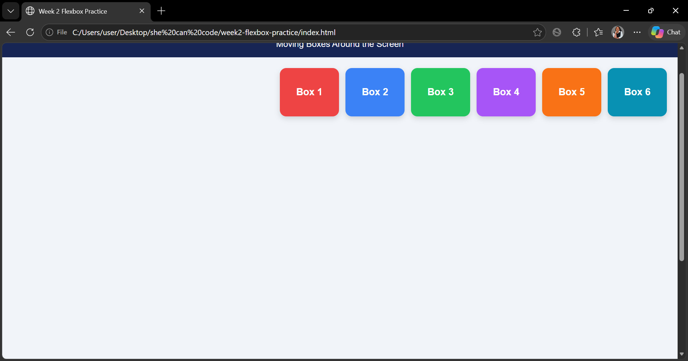
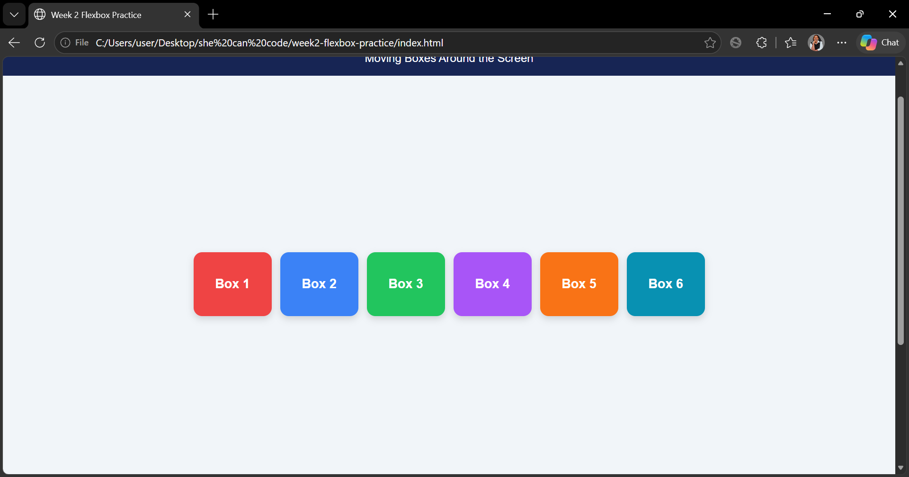
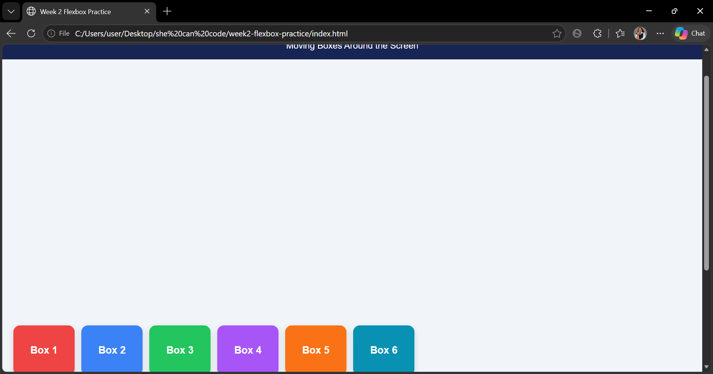

# Week 2 Flexbox Practice: Moving Boxes Around the Screen

**Student Name:** SARO Nelly Hornella Vanessa

**Course:** Advanced Frontend Web Development

## Project Description

This project demonstrates how CSS Flexbox can arrange and move boxes around a full-screen container. Six colorful boxes move through nine different positions using CSS animations.

The project uses only HTML and CSS. No JavaScript is used.

## Technologies Used

- HTML5
- CSS3
- CSS Flexbox
- CSS Keyframes Animation

## Flexbox Properties Explained

1. **display: flex** – Creates a flex container.
2. **justify-content** – Aligns items horizontally.
3. **align-items** – Aligns items vertically.
4. **align-content** – Aligns multiple flex lines.
5. **flex-direction** – Defines the direction of flex items.
6. **flex-wrap** – Allows items to wrap onto another line.
7. **gap** – Creates space between flex items.

## The Nine Flexbox Positions

| Position | justify-content | align-items |
|---|---|---|
| Top Left | flex-start | flex-start |
| Top Center | center | flex-start |
| Top Right | flex-end | flex-start |
| Middle Left | flex-start | center |
| Center | center | center |
| Middle Right | flex-end | center |
| Bottom Left | flex-start | flex-end |
| Bottom Center | center | flex-end |
| Bottom Right | flex-end | flex-end |

## Animation

The project uses CSS `@keyframes` to move the six boxes through all nine positions.

- Animation duration: 18 seconds.
- Animation iteration: infinite.
- Animation properties: justify-content and align-items.

## Extra Flexbox Layout

An additional layout demonstrates:

- flex-direction: column
- flex-wrap: wrap
- align-items: center
- align-content: center
- gap: 12px

## Screenshots

### 1. Top Left

### 2. Center

### 3. Bottom Right

## Video Demonstration

Video link: **[Add your YouTube Unlisted or Google Drive video link here]**

## How to Run the Project

1. Download or clone this repository.
2. Open the project folder.
3. Open `index.html` in your browser.
4. Watch the boxes move through all nine positions.

## Author

SARO Nelly Hornella Vanessa